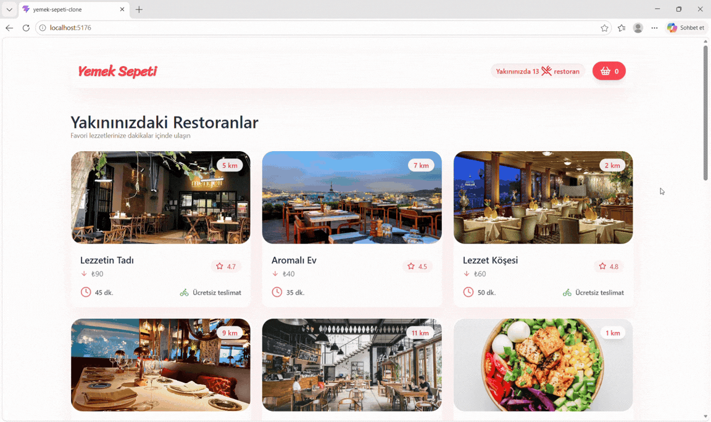

# Yemek Sepeti Clone

A modern, responsive food ordering web application inspired by popular food delivery platforms. Built with React and modern frontend technologies, the application allows users to browse restaurants, explore restaurant details, view products, and manage their shopping cart through an intuitive user interface.

## Features

- Browse and list restaurants
- View restaurant details and available products
- Add products to the shopping cart and remove them
- Manage application state using Redux
- Handle asynchronous operations with Redux Thunk
- Fetch data from a mock REST API
- Navigate between pages using React Router DOM
- Responsive and modern user interface

## Technologies Used

- **React 19** — Component-based UI development
- **Vite** — Fast development server and build tool
- **Redux** — Centralized state management
- **Redux Thunk** — Asynchronous Redux actions
- **React Router DOM** — Client-side routing
- **Axios** — HTTP requests and API integration
- **Tailwind CSS 4** — Utility-first styling
- **JSON Server** — Mock REST API
- **Lucide React** — Icon library

## Project Overview

This project focuses on building a real-world food ordering experience while practicing component-based architecture, centralized state management, API integration, asynchronous data fetching, and modern frontend development practices.

The application provides a structured foundation for restaurant browsing and cart management, combining reusable React components with Redux-powered state management and a responsive interface.

## Preview

